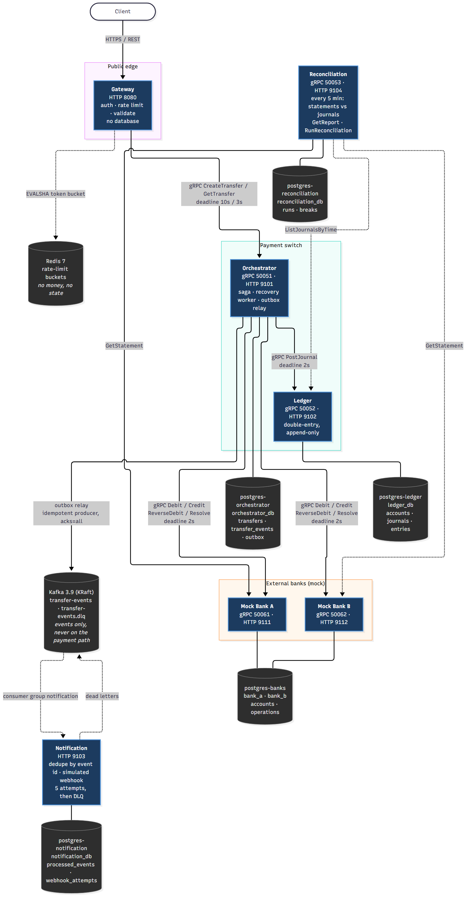
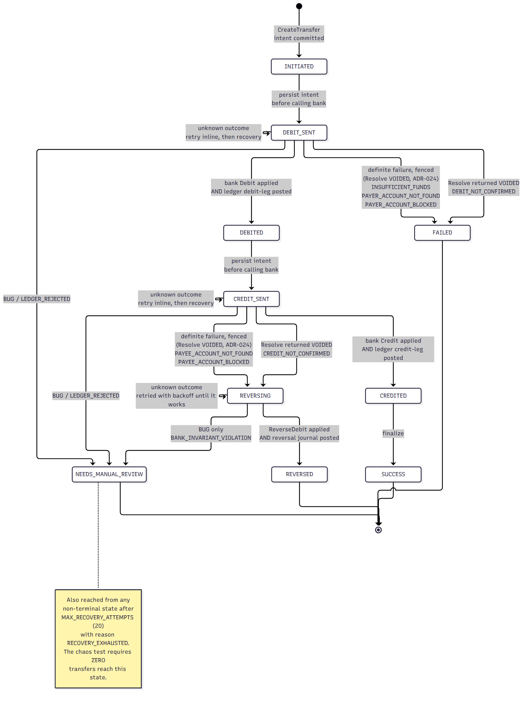

# Payment Switch + Double-Entry Ledger

## 1. What it is

A mini UPI-style payment switch that moves money between accounts at two independent banks.
Every movement is recorded in an append-only double-entry ledger whose journals must balance.
Each transfer happens exactly once, even when banks time out, responses are lost, or the switch crashes mid-transfer.

## 2. Architecture



Four services, no shared databases, gRPC between them, HTTP only at the edge:

| Service | Ports | Owns | Calls |
|---|---|---|---|
| Gateway | HTTP 8080 | nothing durable (Redis holds rate-limit buckets only) | Orchestrator |
| Orchestrator | gRPC 50051, HTTP 9101 | `orchestrator_db`: `transfers`, `transfer_events` | both banks, Ledger |
| Ledger | gRPC 50052, HTTP 9102 | `ledger_db`: `accounts`, `journals`, `entries` | nothing |
| Mock Bank A / B | gRPC 50061 / 50062, HTTP 9111 / 9112 | `bank_a` / `bank_b` | nothing |

Each transfer is a persisted state machine driven by the Orchestrator. It has ten states,
four of them terminal, and **a timeout never changes the state**:



The `*_SENT` states are write-ahead: they are committed **before** the bank is called,
so a crash at any point leaves a row that says exactly what might have happened.

| Walkthrough | Diagram |
|---|---|
| Success, finishing inline | [`sequence-happy-path.png`](docs/diagrams/sequence-happy-path.png) |
| Payee missing, so the debit is reversed | [`sequence-credit-fails.png`](docs/diagrams/sequence-credit-fails.png) |
| Orchestrator crashes after the bank applied the debit | [`sequence-crash-recovery.png`](docs/diagrams/sequence-crash-recovery.png) |

The Mermaid sources live next to the PNGs in [`docs/diagrams/`](docs/diagrams/).
[`ARCHITECTURE.md`](ARCHITECTURE.md) is the full specification, and
[`docs/CONTEXT.md`](docs/CONTEXT.md) is a short orientation.

## 3. Quick start

You need Docker (with Compose v2) and Node 22 or later.

```bash
npm ci
npm run build        # generates the gRPC code; the seed script and the tests use it
npm run stack:up     # docker compose up -d --build --wait: 9 containers, all healthy
npm run seed         # ACC001-ACC005 on bank_a and bank_b, 10,000,000 paise each
```

`npm run seed` is idempotent: run it again and it reports the accounts as already
there, without touching their balances.

The development stack ships with an API client `demo-client` / `demo-secret`, set in
`docker-compose.yml`. The secrets there are for local development only.

**1. Get a token** (an HS256 JWT, valid for 15 minutes):

```bash
TOKEN=$(curl -s -X POST localhost:8080/v1/auth/token \
  -H 'Content-Type: application/json' \
  -d '{"client_id":"demo-client","client_secret":"demo-secret"}' \
  | node -pe 'JSON.parse(require("fs").readFileSync(0)).access_token')
```

**2. Create a transfer.** Amounts are integer paise, so 12500 is ₹125.00. The
`Idempotency-Key` identifies this one payment intent:

```bash
KEY=$(node -e 'console.log(crypto.randomUUID())')
BODY='{"payer":{"bank_id":"bank_a","account_id":"ACC001"},
       "payee":{"bank_id":"bank_b","account_id":"ACC002"},
       "amount":12500,"currency":"INR","note":"dinner"}'

curl -i -X POST localhost:8080/v1/transfers \
  -H "Authorization: Bearer $TOKEN" -H "Idempotency-Key: $KEY" \
  -H 'Content-Type: application/json' -d "$BODY"
```

```http
HTTP/1.1 201 Created
x-request-id: 262dbb62-3430-4419-8d59-b0eac5ea3ac8

{"id":"56761bc6-bca3-4b98-9069-683e60c4f103","status":"SUCCEEDED","state":"SUCCESS",
 "payer":{"bank_id":"bank_a","account_id":"ACC001"},"payee":{"bank_id":"bank_b","account_id":"ACC002"},
 "amount":12500,"currency":"INR","note":"dinner","failure_code":null,"failure_message":null,
 "created_at":"2026-10-06T21:23:33.051Z","updated_at":"2026-10-06T21:23:33.218Z"}
```

**3. Replay it.** Send the same request again with the same key. You get the same
transfer back with `200` and `Idempotent-Replay: true`, and no money moves a second time:

```bash
curl -i -X POST localhost:8080/v1/transfers \
  -H "Authorization: Bearer $TOKEN" -H "Idempotency-Key: $KEY" \
  -H 'Content-Type: application/json' -d "$BODY"
```

```http
HTTP/1.1 200 OK
idempotent-replay: true

{"id":"56761bc6-bca3-4b98-9069-683e60c4f103","status":"SUCCEEDED","state":"SUCCESS", ...}
```

The same key with a **different** body (here, a different amount) is refused:

```http
HTTP/1.1 409 Conflict

{"error":{"code":"IDEMPOTENCY_KEY_REUSED","message":"idempotency key was already used with a different request body",...}}
```

A business failure is `422` with the final state. Here the payee `ACC999` does not
exist, so the payer was debited and then refunded:

```http
HTTP/1.1 422 Unprocessable Entity

{"id":"25883192-...","status":"REVERSED","state":"REVERSED", ...,
 "failure_code":"PAYEE_ACCOUNT_NOT_FOUND","failure_message":"account not found", ...}
```

Read a transfer back with `GET /v1/transfers/{id}`. Only the client that created it can
read it.

### Idempotency rules for clients

- Create one fresh key (UUID v4) per payment intent and reuse it for **every retry of
  that intent**.
- Retry on network errors, 429 (after `Retry-After`), 503 and 504. That is safe by
  design.
- Never reuse a key for a different payment. A `409` means exactly that.
- A `202` means the transfer is still in progress. Poll `GET /v1/transfers/{id}` until
  `status` is terminal.
- A replay returns the transfer's **current** state, not a copy of the first response,
  so a request that returned `202 PENDING` can return `SUCCEEDED` on retry.

`npm run stack:down` stops everything and deletes the volumes, so every database is
reset.

## 4. How correctness is proven

Seven invariants are checked against a baseline snapshot taken before each run:

| | |
|---|---|
| **I1** | Every journal balances; the ledger as a whole is zero-sum |
| **I2** | Money is conserved: bank balances sum to the baseline; none is negative |
| **I3** | Nothing is left in transit once every transfer is terminal |
| **I4** | The ledger agrees with each bank: balance change plus receivable/payable change is zero |
| **I5** | Exactly-once effects, checked transfer by transfer against what its final state allows |
| **I6** | Everything finished: no non-terminal transfer and **zero** in `NEEDS_MANUAL_REVIEW` |
| **I7** | Replays are idempotent: same transfer id, same final state |

```bash
npm run test:chaos                          # crash recovery + the 10,000-transfer invariant test
TRANSFER_COUNT=1000 npm run test:chaos      # the CI size
npm run invariants                          # I1-I6 against the live stack, every transfer
npm run invariants -- --since 2026-10-07T00:00:00Z   # only transfers created since then
```

**The headline test** sends 10,000 transfers through the Gateway with seeded bank chaos
(5% of calls refused as `UNAVAILABLE`, 2% applied late, 3% with the response lost, 5–50 ms latency), 5% duplicate
requests and 5% transfers to payees that do not exist. It SIGKILLs the Orchestrator three
times mid-run. It has passed twice in a row with different workload seeds, locally and
on GitHub Actions:

| Run | Test seed | Requests | Final states | Manual review | Invariants |
|---|---|---|---|---|---|
| M7, 2026-10-06 | 1 | 10,486 | 9,467 `SUCCESS`, 518 `REVERSED`, 15 `FAILED` | 0 | I1–I7 hold |
| M7, 2026-10-06 | 2 | 10,486 | 9,397 `SUCCESS`, 524 `REVERSED`, 79 `FAILED` | 0 | I1–I7 hold |
| M9, 2026-10-07 | 1 | 10,486 | 9,466 `SUCCESS`, 519 `REVERSED`, 15 `FAILED` | 0 | I1–I7 hold |
| M9, 2026-10-07 | 2 | 10,486 | 9,393 `SUCCESS`, 523 `REVERSED`, 84 `FAILED` | 0 | I1–I7 hold |
| CI nightly, after ADR-024 | 1 | 10,486 | 9,468 `SUCCESS`, 520 `REVERSED`, 12 `FAILED` | 0 | I1–I7 hold |
| CI nightly, after ADR-024 | 2 | 10,486 | 9,407 `SUCCESS`, 525 `REVERSED`, 68 `FAILED` | 0 | I1–I7 hold |

The first nightly run on GitHub, before ADR-024, failed seed 2: a timed-out debit applied
after the transfer had failed on a refused retry. I5 caught it, transfer by transfer. The
rows above are from runs that passed; see
[ADR-024](docs/decisions/ADR-024-fence-definite-failures.md) for the bug and the fix.

The same seed can end with slightly different counts. The seed fixes the workload, but
100 concurrent requests interleave differently each run, so a payer near zero may or may
not have been refilled before its next debit. The invariants hold either way.

**The crash recovery test** SIGKILLs the Orchestrator while 200 transfers are in flight,
restarts it, and requires every one to end in `SUCCESS` with I1–I6 holding.

The chaos tests scope their checks to their own accounts and transfers, and
`npm run invariants -- --since` does the same per transfer
([ADR-021](docs/decisions/ADR-021-chaos-and-invariant-checks.md)). The unscoped command
checks every transfer the stack has ever seen; run it once the stack is quiet, because a
transfer still in flight counts as a violation.

**In CI:** every push runs the integration suite and a 1,000-transfer chaos run on a fresh
GitHub Actions stack, and the nightly job runs the full 10,000-transfer test with two
seeds, then the unscoped checker
([`.github/workflows/ci.yml`](.github/workflows/ci.yml)).

## 5. Failure scenarios handled

A short version of the table in `ARCHITECTURE.md` section 13, with the test that
exercises each scenario.

| # | Scenario | Outcome | Exercised by |
|---|---|---|---|
| 1–2 | Insufficient funds, or the payer account is missing or blocked | Fenced with `Resolve` first, then `FAILED` with the matching code; nothing to undo ([ADR-024](docs/decisions/ADR-024-fence-definite-failures.md)) | `orchestrator.test.ts`, `failurePaths.test.ts` |
| 3 | Debit outcome unknown (timeout, `UNAVAILABLE`) | Retried inline, then by recovery; after 3 attempts `Resolve` decides | `idempotency.test.ts`, `failurePaths.test.ts` (bank down) |
| 4 | Debit applied but the response lost | The retry returns the original `APPLIED`; one debit only | `failurePaths.test.ts` (`lost_response_rate = 1`) |
| 5 | A debit or credit arrives late, after the switch gave up or after the bank refused a retry | The `Resolve` tombstone makes it fail with `REFERENCE_VOIDED`; it never applies | `failurePaths.test.ts` (`late_apply_rate = 1`, "fenced against a late request"), `mockBank.test.ts` |
| 6, 10 | Orchestrator crashes in `DEBIT_SENT` or `CREDIT_SENT` | The lease expires; another instance repeats the idempotent step and finishes | `failurePaths.test.ts`, `crashRecovery.test.ts` |
| 7 | Ledger down after a successful bank debit | Stays `DEBIT_SENT`, retried with backoff; completes when the Ledger returns | `failurePaths.test.ts` |
| 8 | Payee account missing or blocked | Fenced with `Resolve`, then `REVERSING`: refund the payer, post the reversal journal, `REVERSED` | `orchestrator.test.ts`, `failurePaths.test.ts` |
| 9 | Credit outcome unknown after retries | `Resolve` on the payee bank: `APPLIED` continues, `VOIDED` reverses | `recovery/worker.test.ts`, the invariant test |
| 11 | `ReverseDebit` fails transiently | Stays `REVERSING`, retried until it works; never voided | `recovery/worker.test.ts` |
| 12 | Client retries while the first request is still running | Returns the latest state; no second saga | `idempotency.test.ts` |
| 13 | An Orchestrator killed with many transfers in flight | Every lease expires; recovery finishes them all | `crashRecovery.test.ts`, the invariant test |
| 14 | Recovery exhausted, or the Ledger rejects a journal | `NEEDS_MANUAL_REVIEW` plus an alert metric; the chaos test requires zero | `recovery/worker.test.ts`, `saga.test.ts` |

The distinction everything rests on: **a timeout is not a failure.** It is an unknown
outcome, settled by the bank's `Resolve` call. `Resolve` writes a tombstone, so a late
request can never apply after the transfer was given up on
([ADR-002](docs/decisions/ADR-002-resolve-tombstones.md)). Even a definite refusal is
fenced the same way before the switch acts on it, because an earlier attempt for the
same reference may still be on its way ([ADR-024](docs/decisions/ADR-024-fence-definite-failures.md)).

## 6. Benchmarks

Copied from [`docs/benchmarks.md`](docs/benchmarks.md), which has the full method,
machine and analysis. All runs: 2026-10-06, commit `9f985fa`, chaos **off**, k6
`constant-arrival-rate` for 2 minutes, cross-bank transfers between random load-test
accounts. Machine A is an AMD Ryzen 7 7840HS (8 cores, 16 threads), 15.2 GB RAM,
Windows 11, Docker Desktop on WSL2, one instance of every service. Invariants were
checked after every run.

| Target rate | Achieved RPS | p50 | p95 | p99 | Error rate | Invariants after the run |
|---|---|---|---|---|---|---|
| 200/s (spec scenario) | 129.7 (8,233 iterations dropped: saturated) | 3.05 s | 3.37 s | 3.51 s | 0.00 % (0 of 15,772) | hold: 15,768 transfers |
| 100/s | 99.97 | 85.4 ms | 564.1 ms | 792.2 ms | 0.00 % (0 of 12,005) | hold: 12,001 transfers |
| 75/s | 74.99 | 71.9 ms | 95.7 ms | 132.4 ms | 0.00 % (0 of 9,004) | hold: 9,000 transfers |

Thresholds (chaos off): `http_req_failed < 1%` was met at every rate. `p(95) < 500 ms`
was met at 75/s, missed narrowly at 100/s, and missed at 200/s.

**The bottleneck is one Orchestrator process's CPU.** Under the 200/s target the
Orchestrator container sat at 102–106 % CPU, one core for Node's single event loop,
while every other container had headroom. Turning logging down to `warn` did not change
the ceiling. A CPU profile showed the cost spread across socket writes, gRPC/HTTP/2 and
Postgres round trips, with no single hotspot. The design already allows more
Orchestrator instances (leases, `SKIP LOCKED`, compare-and-set), but that was not built
or measured, so no number is claimed for it.

## 7. Design decisions and tradeoffs

The eight decisions the specification makes:

| ADR | Decision | The tradeoff |
|---|---|---|
| [001](docs/decisions/ADR-001-orchestrated-saga.md) | Orchestrated saga instead of two-phase commit | A visible debited-not-credited window (held in `transit`) in exchange for no distributed commit |
| [002](docs/decisions/ADR-002-resolve-tombstones.md) | `Resolve` with tombstones to settle unknown outcomes | The bank needs one extra RPC; an unknown outcome becomes final in bounded time |
| [003](docs/decisions/ADR-003-derived-ledger-balances.md) | Derived ledger balances, no hot balance row | Balance reads aggregate entries; writes never contend on `transit` |
| [004](docs/decisions/ADR-004-isolation-levels.md) | `READ COMMITTED` for writes, `REPEATABLE READ` for aggregates | Correctness rests on constraints and atomic statements, not on `SERIALIZABLE` retries |
| [005](docs/decisions/ADR-005-idempotency-three-layers.md) | Idempotency on the transfer row, in three layers | Replays return current state, not the first response |
| [006](docs/decisions/ADR-006-rate-limiter-fails-open.md) | The rate limiter fails open | A Redis outage removes the limit rather than stopping payments |
| [007](docs/decisions/ADR-007-database-per-service.md) | Database per service; one shared Postgres only for the mock banks | No cross-service transaction is even possible, which forces the saga to be right |
| [008](docs/decisions/ADR-008-recovery-by-lease-and-skip-locked.md) | Recovery by lease and `SKIP LOCKED`, not a message queue | Up to `LEASE_MS` + one poll of takeover latency; no second store of pending work |

Where the implementation fills a gap in the specification or deviates from it:

| ADR | Decision |
|---|---|
| [009](docs/decisions/ADR-009-node-22-fastify-5.md) | Node 22 LTS and Fastify 5, not Node 20 (end of life) and Fastify 4 |
| [010](docs/decisions/ADR-010-inline-saga-budget.md) | The inline saga budget is a hard bound; `202` is a normal outcome |
| [011](docs/decisions/ADR-011-buf-lint-exceptions.md) | Four `buf lint` exceptions for the verbatim contracts |
| [012](docs/decisions/ADR-012-ts-proto-plugin-invocation.md) | Run the ts-proto plugin through `node` (Windows) |
| [013](docs/decisions/ADR-013-vitest-projects.md) | Test layers as vitest projects |
| [014](docs/decisions/ADR-014-migration-checksums.md) | Migration checksums, one transaction per batch |
| [015](docs/decisions/ADR-015-ledger-forbid-truncate.md) | The ledger also forbids `TRUNCATE` |
| [016](docs/decisions/ADR-016-mock-bank-unspecified-details.md) | Mock Bank details the spec leaves open |
| [017](docs/decisions/ADR-017-ledger-invariant-rejections.md) | Ledger database-invariant rejections are `FAILED_PRECONDITION`, so they go to manual review |
| [018](docs/decisions/ADR-018-orchestrator-unspecified-details.md) | Orchestrator details the spec leaves open (the CAS also matches `state`) |
| [019](docs/decisions/ADR-019-gateway-details.md) | `@fastify/jwt` 10 (v9 had critical advisories) and Gateway details |
| [020](docs/decisions/ADR-020-recovery-details.md) | Recovery worker details (`Resolve` in the saga, lease renewal per drive) |
| [021](docs/decisions/ADR-021-chaos-and-invariant-checks.md) | How the chaos tests and the invariant checker scope their checks |
| [022](docs/decisions/ADR-022-load-test-details.md) | Load test and seed details |
| [023](docs/decisions/ADR-023-m9-polish-details.md) | CI job layout, diagram rendering, readiness probes in `repo/` |
| [024](docs/decisions/ADR-024-fence-definite-failures.md) | A definite bank refusal is fenced with `Resolve` before the failure branch (found by the first nightly CI run) |

## 8. What I built and why

Five lines after each milestone, each one explainable out loud without notes.

**M0 — Scaffold**
1. One npm-workspaces monorepo: shared code in `packages/`, each service in `services/`. Services share libraries but never a database or a process.
2. Service contracts are `.proto` files, and TypeScript types are generated from them. A field mismatch between two services is a compile error, not a production bug.
3. `classify()` sorts every downstream error into definite failure, unknown outcome or bug. Anything unrecognised counts as *unknown*, because a timeout must never be treated as a failure.
4. Retries are explicit and opt-in: gRPC's built-in retries are off, and `withRetry` needs a predicate, so a definite failure can't be retried by accident.
5. Migrations run under a Postgres advisory lock, all pending files in one transaction, with checksums so an edited migration stops startup.

**M1 — Ledger**
1. A double-entry ledger in which balances are derived by summing entries, never stored. So `transit`, touched by every transfer, never becomes a hot row that serialises all traffic.
2. "Every journal balances" is enforced twice: by validation in the app and by a deferred constraint trigger at COMMIT. A mutation test proved the trigger catches what the app misses.
3. The ledger is append-only in the database itself. Triggers reject UPDATE, DELETE and (beyond the spec, ADR-015) TRUNCATE, so history can't be rewritten even with raw SQL.
4. Idempotency comes from a unique key plus `ON CONFLICT DO NOTHING`, with no application locks. 100 concurrent identical posts produce one journal and 99 replays.
5. A reused key with a different body is rejected using a hash of the canonical request, so a retry can never silently post different amounts.

**M2 — Mock Bank**
1. A simulated external bank, run as two instances with separate databases. Every money operation is idempotent by `(reference_id, operation)`, the table's primary key.
2. Double-spend is impossible: the balance check and the decrement are one conditional `UPDATE`. 50 concurrent debits against funds for 10 yield exactly 10.
3. `Resolve` turns "did it happen?" into a permanent answer by inserting a tombstone. A late debit that arrives after it fails with `REFERENCE_VOIDED`, so money can never move after the switch gave up on it.
4. That race is tested for real: Debit and Resolve fire together on separate connections, each side wins sometimes, and every pair gets one consistent answer.
5. A seeded chaos engine (mulberry32) injects outages, rejections, late applies and lost responses. The same seed gives the same failures, so chaos bugs can be reproduced.

**M3 — Orchestrator core**
1. The Orchestrator runs each transfer as a persisted state machine. It commits the intent (`DEBIT_SENT`) before it calls the bank, so a crash at any point leaves a row that says exactly what might have happened.
2. Every state change is a compare-and-set on version, state and lease owner, plus an audit event, in one transaction. A driver that lost the transfer writes nothing. That was tested by racing three writers against one row.
3. An error is classified before the saga reacts. A definite "no" fails or reverses the transfer, a timeout leaves the state unchanged and is retried, and a broken invariant goes to manual review. A planted bug that treated timeouts as failures failed 5 tests.
4. The inline time budget is a hard bound (ADR-010): every call's deadline is clipped to the time left, so the Orchestrator always answers before the Gateway gives up. When the budget runs out the transfer is handed to recovery (`202`), never failed.
5. Ledger database-trigger rejections now come back as `FAILED_PRECONDITION`, not `INTERNAL` (ADR-017). A bug the database catches goes straight to manual review instead of being retried for minutes.

**M4 — Gateway**
1. The Gateway is the only HTTP entry point and has no transfer logic: it authenticates, rate-limits, validates with strict zod schemas, and translates REST to gRPC and back.
2. The `client_id` always comes from the signed JWT's `sub`, never from the body or a header. Tokens are HS256 only, and a client removed from config is locked out immediately, not when its token expires.
3. Rate limiting is a token bucket in Redis, run atomically as a Lua script with `EVALSHA` and Redis's own clock. If Redis is down the limiter fails open (ADR-006), because a load control must never stop payments.
4. Status codes carry meaning a client can act on. 201 is a new success and 200 a replay of one, 422 is a business failure, and 202 plus `Location` means "still in flight, poll". Each gRPC error maps to exactly one HTTP error.
5. Security-relevant details are pinned by tests: secrets are compared in constant time, nothing secret is ever logged, and a vulnerable JWT library was replaced (ADR-019). A test caught tokens that would have lived 10 days instead of 15 minutes.

**M5 — Idempotency & unknown outcomes**
1. A retry can never move money twice. Each layer has its own key and its own database constraint: client to switch, switch to bank, switch to ledger.
2. A reused key with a different body is rejected (409) using a SHA-256 fingerprint of the canonical request, so a client bug can't silently send a different amount.
3. 50 identical requests fired at once produce one transfer, one saga and one bank debit. The unique index picks the winner; the losers wait briefly and return the winner's result.
4. A replay never drives a transfer; only its owner or the recovery worker does. Every state change records the request that caused it, and a test checks that no state change ever carries the replay's request id.
5. A timeout isn't a failure. Unknown outcomes are retried inline with the same idempotent request, and if that runs out the transfer is handed to recovery with backoff, never failed. Six planted bugs in this logic were each caught by a test.

**M6 — Recovery**
1. Every Orchestrator runs a recovery loop that claims stuck transfers with `FOR UPDATE SKIP LOCKED` under a time-limited lease, so several instances share the work and no two drive the same transfer.
2. After three failed attempts the switch stops guessing and asks the bank's `Resolve`, which gives a final answer: applied, so continue, or voided, so fail or refund. A reversal is never voided; it is retried until it works.
3. The tombstone race is proven for real: debits held 45 seconds at the bank arrive after `Resolve` voided them, all nine are refused, and the payer's balance never moves.
4. A SIGKILLed Orchestrator mid-transfer is finished by a second instance, and only after the dead one's lease expired. Every state change records which driver and lease made it.
5. Recovery has a budget: 20 attempts, then manual review with an alert metric. Transfers from earlier test runs left mid-debit were all completed with exactly one debit, one credit and both ledger legs.

**M7 — Chaos & invariants**
1. 10,000 transfers under seeded chaos (5% rejected, 2% applied late, 3% with lost responses) and three Orchestrator SIGKILLs: every invariant held, twice in a row with different seeds, and nothing needed manual review.
2. Seven invariants are checked against a baseline: every journal balances, money is conserved, `transit` returns to zero, the ledger agrees with each bank, effects are exactly-once per transfer, everything finishes, and replays are idempotent.
3. "Exactly once" is checked transfer by transfer: each one's bank operations and journals are fetched from the services and compared, by final state, against what that state allows.
4. 200 transfers in flight when the Orchestrator was killed (SIGKILL) all ended in `SUCCESS`, finished by the recovery worker after restart.
5. The checker found real corruption: books deliberately broken by an earlier mutation test (a missing reversal journal, a wrong ledger account), down to the exact paise.

**M8 — Load & metrics**
1. Load tests with k6 (constant arrival rate, 2 minutes) against the full Docker stack. Every number is in `docs/benchmarks.md` with its machine and commit, and every run was followed by a green invariant check.
2. On a Ryzen 7 7840HS laptop under Docker Desktop, the stack sustained 74.99 transfers/s at p95 95.7 ms and 99.97/s with 0.00% errors, and saturated at 129.7/s (against a 200/s target), still with 0.00% errors.
3. I found the ceiling by measuring, not guessing: one Orchestrator process saturates a CPU core. Logging was ruled out by turning it off (no change), and a CPU profile showed the cost spread across gRPC, Postgres round trips and socket writes.
4. The design already scales horizontally (leases, `SKIP LOCKED`, compare-and-set), so the next step is more Orchestrator instances behind gRPC load balancing. It isn't built, so no number is claimed for it.
5. Every metric in the spec is exposed, with the right type and labels, and an integration test pins all of them across the five services.

**M9 — Polish**
1. Every claim in this README traces to something checked: benchmark figures are copied from `docs/benchmarks.md`, the curl responses are real, and each failure scenario names the test that exercises it.
2. CI has three layers: static checks on every push, then the real Docker stack running the integration suite and a 1,000-transfer chaos run, and every night the full 10,000-transfer test twice with different seeds, so the headline result is re-proven rather than claimed once.
3. The five diagrams are rendered from Mermaid source kept in the repo. Rendering them caught a real defect: `#` starts a comment in a Mermaid name, which silently merged the two Orchestrator instances in the crash-recovery diagram.
4. The readiness checks' `SELECT 1` moved into each service's `repo/` layer, so "SQL lives only in `repo/`" now has no exceptions, and a search of the source confirms it.
5. The first nightly CI run found a real exactly-once bug the spec itself allowed: a debit that timed out applied *after* a retry was refused for insufficient funds and the transfer had failed. Now every refusal is fenced with the bank's `Resolve` before the switch acts on it (ADR-024), proven red then green by tests that replay the late request.
